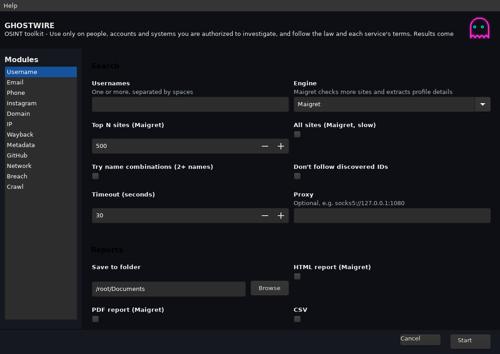

<div align="center">



<br>

<a href="https://github.com/metalmike17/Ghostwire-OSINT/releases/latest"></a>
<a href="LICENSE"></a>


<a href="https://github.com/metalmike17/Ghostwire-OSINT/stargazers"></a>

<br><br>

**[⬇️ Download](https://github.com/metalmike17/Ghostwire-OSINT/releases/latest)** &nbsp;·&nbsp;
**[⚡ Modules](#-modules)** &nbsp;·&nbsp;
**[🚀 Install](#-getting-started)** &nbsp;·&nbsp;
**[🤝 Contribute](CONTRIBUTING.md)** &nbsp;·&nbsp;
**[🗺️ Roadmap](#%EF%B8%8F-roadmap)**

<br>



</div>


**Every OSINT tool you actually use, in one neon-lit cockpit.**

You've got Sherlock in one terminal, Holehe in another, a half-remembered `dig`
one-liner in your shell history, and fourteen browser tabs open to breach
checkers. GHOSTWIRE pulls all of it into a single dark-themed desktop app:
pick a module in the sidebar, fill in a target, hit **Start**, and watch the
results stream into a cyan-on-black terminal. No flags to remember, no
copy-pasting between tools.

> Built with [Gooey](https://github.com/chriskiehl/Gooey), so it's a real
> native GUI that is still just a Python script underneath. Every module is
> readable, hackable and easy to extend.


## ⚡ Modules

| Module | What it does | Powered by |
|---|---|---|
| **Username** | Hunt a handle across hundreds to thousands of sites. Search the top N sites or all of them, try name permutations, follow IDs discovered along the way, and export HTML, PDF, CSV or TXT reports. | Maigret, Sherlock |
| **Email** | Build an email's footprint: mail-server (MX) check, public Gravatar profile with linked accounts, and which sites the address is registered on. Password-recovery probes are **off by default** so you don't send reset emails to your target. | Holehe, Gravatar, DNS |
| **Phone** | Scan an international-format number for carrier, region and line info. | PhoneInfoga |
| **Instagram** | Pull public profile data, with optional recent-post downloads and saved-session support for when Instagram blocks anonymous lookups. | Instaloader |
| **Domain** | WHOIS, DNS records (A, AAAA, MX, NS, TXT, SOA, CNAME), HTTP headers, `robots.txt` and `security.txt`, subdomain enumeration, live-host probing, and email/host harvesting. | subfinder (falls back to crt.sh), httpx, theHarvester |
| **IP** | Geolocation, ownership and reverse DNS for IPs or hostnames. | ipinfo.io |
| **Wayback** | Browse the latest Internet Archive snapshots of any URL, with direct links to each capture. | Wayback CDX API |
| **Metadata** | Dig EXIF and GPS coordinates out of photos. Add `exiftool` to extend it to PDFs, Office documents and video. | Pillow, exiftool |
| **GitHub** | Recon a GitHub user: profile, repos, and (optionally) email addresses leaked in public commits. | GitHub API |
| **Network** | Port and service scanning with preset profiles, custom ports, NSE scripts and saved output. | Nmap |
| **Breach** | Check emails against known breaches with a free no-key source (including a risk score) or HaveIBeenPwned. Check a password too, **without sending it anywhere**, using k-anonymity range lookups. | XposedOrNot, HIBP, Pwned Passwords |
| **Crawl** | Spider a site for emails, links, JS files and exposed keys or secrets, optionally seeded from the Wayback Machine. | Photon |

Every module shares proxy support (e.g. `socks5://127.0.0.1:1080`), adjustable
timeouts, multi-target input, and a save-to-folder option.


## 🎨 The look

A cyberpunk palette: ink-black background, neon cyan terminal text, magenta
errors, and a sidebar that stays out of your way. It's easy on the eyes during
long investigations and it looks good in screenshots.


## 🚀 Getting started

Grab a build from the [latest release](https://github.com/metalmike17/Ghostwire-OSINT/releases/latest).
Linux builds are made on glibc 2.35 and run on Ubuntu 22.04+, Debian 12+, Fedora, Arch and similar.

| Platform | File | Install |
|---|---|---|
| Any Linux (x86_64) | `GHOSTWIRE-x86_64.AppImage` | `chmod +x GHOSTWIRE-x86_64.AppImage && ./GHOSTWIRE-x86_64.AppImage` |
| Debian / Ubuntu / Mint / Kali | `ghostwire_0.1.0_amd64.deb` | `sudo apt install ./ghostwire_0.1.0_amd64.deb` |
| Fedora / RHEL / openSUSE | `ghostwire-0.1.0-1.x86_64.rpm` | `sudo dnf install ./ghostwire-0.1.0-1.x86_64.rpm` |
| Arch / Manjaro | `packaging/PKGBUILD` | `cd packaging && makepkg -si` |
| Flatpak | `GHOSTWIRE-x86_64.flatpak` | `flatpak install --user GHOSTWIRE-x86_64.flatpak` |
| Any Linux (tarball) | `ghostwire-0.1.0-linux-x86_64.tar.gz` | extract, run `./run-ghostwire.sh` |
| Windows / macOS / Linux ARM64 | built by CI (experimental) | see the [Actions](https://github.com/metalmike17/Ghostwire-OSINT/actions) tab |

**From source:**

```bash
git clone https://github.com/metalmike17/Ghostwire-OSINT.git
cd Ghostwire-OSINT

python -m venv .venv && source .venv/bin/activate
pip install gooey requests dnspython pillow instaloader maigret sherlock-project holehe

python ghostwire.py
```

GHOSTWIRE finds tools in its own virtualenv first, then `~/.local/bin`, then your `PATH`.

**Optional external tools.** Modules tell you what's missing, and only the
modules that need a tool depend on it:

- `nmap` (Network), `whois` (Domain), `phoneinfoga` (Phone), `subfinder` and `httpx` (Domain), `exiftool` (Metadata)
- [theHarvester](https://github.com/laramies/theHarvester) and [Photon](https://github.com/s0md3v/Photon), cloned into `~/.local/share/ghostwire-tools/`


## ⚖️ Use it responsibly

GHOSTWIRE only uses public sources, but how you use it is on you. Investigate
only people, accounts and systems you are authorized to look into, follow the
law and each service's terms, and remember that results can be wrong or out of
date. Scan only networks you own or have permission to test.


## 🤝 Contributing

Contributions are welcome: new modules, new data sources, bug fixes, UI polish,
docs. See [CONTRIBUTING.md](CONTRIBUTING.md) to get started. Each module is a
`do_<name>` function plus a sub-parser, so adding one is usually an afternoon's work.


## 🗺️ Roadmap

- Saved investigations and case notes
- Combined cross-module reports (HTML / PDF)
- More data sources and modules
- **GHOSTWIRE PRO** is in the works, with advanced features for professional investigators. Stay tuned.

---

*GHOSTWIRE is not affiliated with the third-party tools it wraps. Each belongs to its respective authors and carries its own license.*

## 📄 License

[MIT](LICENSE)
